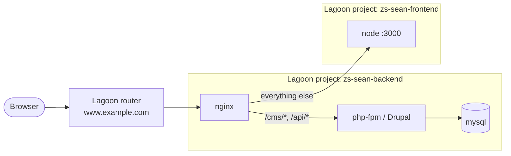

# zs-sean-backend: a split Drupal + frontend site on Lagoon

This project is an example of a **split project** on [Lagoon](https://docs.lagoon.sh/): the Drupal backend and the frontend are deployed as **two separate Lagoon projects**, but visitors only see **one domain**.

This repository is the backend. It owns the public domain and its nginx decides where each request goes:

| Path | Served by |
| --- | --- |
| `/cms/*` | Drupal (this project) |
| `/api/*` | Drupal (this project), handled as `/cms/api/*` |
| everything else | the frontend project, at `FRONTEND_HOST:FRONTEND_PORT` |



Because the frontend is a different Lagoon project, it lives in a different Kubernetes namespace. The backend's nginx reaches it over the cluster network, so the frontend needs a **network policy** that allows this project in (see [Frontend project requirements](#frontend-project-requirements)).

## How the routing works

All of the routing lives in two files, which `lagoon/nginx.dockerfile` copies into the `uselagoon/nginx-drupal` image:

* [`lagoon/app.conf`](lagoon/app.conf) replaces the image's default Drupal server block.
* [`lagoon/redirects-map.conf`](lagoon/redirects-map.conf) holds redirect rules.

### Drupal is mounted at `/cms`

Drupal is installed in `web/` as usual, but it is served under `/cms`:

* nginx strips the `/cms` prefix when it looks for static files, so `/cms/core/misc/drupal.js` is served from `web/core/misc/drupal.js`.
* Anything that isn't a file is passed to Drupal with `SCRIPT_NAME=/cms/index.php`, so Drupal treats `/cms` as its base path.

As a result, **every URL Drupal generates starts with `/cms/`**: links, CSS/JS aggregates, image style derivatives and public file URLs. Those requests always route back to Drupal and never reach the frontend.

A bare `/cms` redirects to `/cms/`, because Drupal only detects the base path when the URL has the trailing slash.

The usual protections from the stock image still apply under `/cms`: blocked code files and dot files, plus private, vendor and backup directories.

### `/api` is an alias for `/cms/api`

Requests to `/api/*` go straight to Drupal, which sees them as `/cms/api/*`. Drupal therefore gets the path `/api/...` with the same `/cms` base path. This keeps:

* **One session.** Drupal names its session cookie after the host plus the base path, so a user logged in at `/cms` is also logged in for `/api` calls.
* **Working file URLs.** Image and file URLs in API responses point at `/cms/sites/default/files/...`, which Drupal serves.

Links Drupal builds to itself in API responses look like `/cms/api/...`. They also work.

To serve JSON:API at `/api` (instead of `/cms/jsonapi`), set the JSON:API base path in your services YAML:

```yaml
parameters:
  jsonapi.base_path: /api
```

### Everything else goes to the frontend

All other requests are proxied to `http://${FRONTEND_HOST}:${FRONTEND_PORT}`, including `/`, `/robots.txt` and `/favicon.ico`. nginx passes through the original `Host`, `X-Forwarded-For`, `X-Forwarded-Proto` and `X-Forwarded-Host`, so the frontend can build correct absolute URLs.

| Variable | Lagoon default | Local default (`docker-compose.yml`) |
| --- | --- | --- |
| `FRONTEND_HOST` | `node.zs-sean-frontend-dev.svc` | `zs-sean-frontend-node-1` |
| `FRONTEND_PORT` | `3000` | `3000` |

In Lagoon the frontend host is `<service>.<project>-<environment>.svc`. The default only fits the `dev` environment, so set `FRONTEND_HOST` per environment with Lagoon environment variables, e.g.:

```bash
lagoon add variable -p zs-sean-backend -e main -N FRONTEND_HOST -V node.zs-sean-frontend-main.svc -S runtime
```

> [!IMPORTANT]
> nginx looks up `FRONTEND_HOST` when it starts. If the name can't be found (for example, a backend environment with no matching frontend environment), nginx won't start, and Drupal goes down with it.

### Redirects

The Lagoon nginx image matches every request's `$host$uri` against `/etc/nginx/redirects-map.conf`. It does this before any routing, so redirects work for both Drupal and frontend paths. The file in this repo explains the rule format and includes examples.

The project ships with one rule:

```nginx
~^[^/]+/user(/.*)?$   /cms/user$1$is_args$args;
```

This sends `/user/*` (login, password reset and one-time login links such as those from `drush uli`) to Drupal at `/cms/user/*`.

Redirect destinations are kept relative (`absolute_redirect off`), so `https` is preserved behind the Lagoon router.

### Real client IPs

`lagoon/nginx.dockerfile` downloads Fastly's public IP ranges at build time and trusts them for `X-Forwarded-For`. This lets nginx and Drupal see the real client IP when the site is behind Fastly.

## Frontend project requirements

The frontend is a separate Lagoon project (e.g. `zs-sean-frontend`). It needs to:

1. **Expose an HTTP service**, e.g. a `node` service listening on port `3000`. It should handle every path except `/cms` and `/api`. To fetch data, it can call Drupal at `/api/*` on the same domain, or reach it inside the cluster.
2. **Allow this project in with a network policy** in its `.lagoon.yml`. Without it, the backend's nginx can't connect:

   ```yaml
   environments:
     main:
       network-policies:
         - service: node
           projects:
             # only the production environment of zs-sean-backend can reach node
             - name: zs-sean-backend
               environment-type: production
     dev:
       network-policies:
         - service: node
           projects:
             # only development environments of zs-sean-backend can reach node
             - name: zs-sean-backend
               environment-type: development
   ```

3. **Not own the public domain.** Routes for the shared domain belong to this backend project. The frontend only needs its autogenerated routes, if any.

## Included services

* Drupal 11
* PHP 8.4 (`cli` and `php` containers)
* nginx (`uselagoon/nginx-drupal`, with the custom routing above)
* MySQL 8.0

## Requirements

* [docker](https://docs.docker.com/install/)
* [pygmy](https://www.github.com/pygmystack/pygmy)

## Local environment setup

Both projects run locally on the shared `amazeeio-network` Docker network. The backend's nginx reaches the frontend by container name.

1. Make sure nothing is running on port 80 on the host, then start pygmy:

    ```bash
    pygmy up
    ```

2. Start the frontend project from its own checkout, so the `zs-sean-frontend-node-1` container is running on `amazeeio-network`:

    ```bash
    cd ../zs-sean-frontend && docker compose up -d
    ```

   If your frontend container has a different name or port, set `FRONTEND_HOST` / `FRONTEND_PORT` in your shell or in `.env` before the next step.

3. Build and start this project:

    ```bash
    docker compose up -d
    docker compose exec cli composer install
    ```

4. Install Drupal:

    ```bash
    docker compose exec cli drush si -y
    ```

5. Visit the site:

   * Frontend: `http://zs-sean-backend.docker.amazee.io/`
   * Drupal: `http://zs-sean-backend.docker.amazee.io/cms/`
   * Log in: `docker compose exec cli drush uli` (the `/user/...` link redirects to `/cms/user/...`)

If any steps fail, you can safely rerun from any point.

## Drupal project template

This project is based on the [Lagoon Drupal base template](https://github.com/lagoon-examples/drupalnext-base). When you run `composer install`:

* Drupal is installed in the `web` directory.
* The composer autoloader (`vendor/autoload.php`) is used instead of Drupal's (`web/vendor/autoload.php`).
* Modules, themes and profiles are placed in `web/modules/contrib/`, `web/themes/contrib/` and `web/profiles/contrib/`.
* The `web/sites/default/files` directory is created.
* [Drush](https://www.drush.org/latest/) is installed at `vendor/bin/drush`.
* Scaffolding for Drupal core is installed, along with Lagoon-specific scaffolding from [amazeeio/drupal-integrations](https://github.com/amazeeio/drupal-integrations) and the `assets/` directory in this repo. See [drupal/core-composer-scaffold](https://github.com/drupal/core-composer-scaffold).

### Updating Drupal core

Drupal core and Drush are pinned to exact versions in `composer.json`, and [Renovate](renovate.json) opens PRs to bump them. To update by hand, change the `drupal/core-*` versions in `composer.json`, then run:

```bash
composer update "drupal/core-*" --with-all-dependencies
```

### Applying patches

Use [composer-patches](https://github.com/cweagans/composer-patches) by adding a `patches` section to `extra` in `composer.json`:

```json
"extra": {
    "patches": {
        "drupal/foobar": {
            "Patch description": "URL to patch"
        }
    }
}
```
